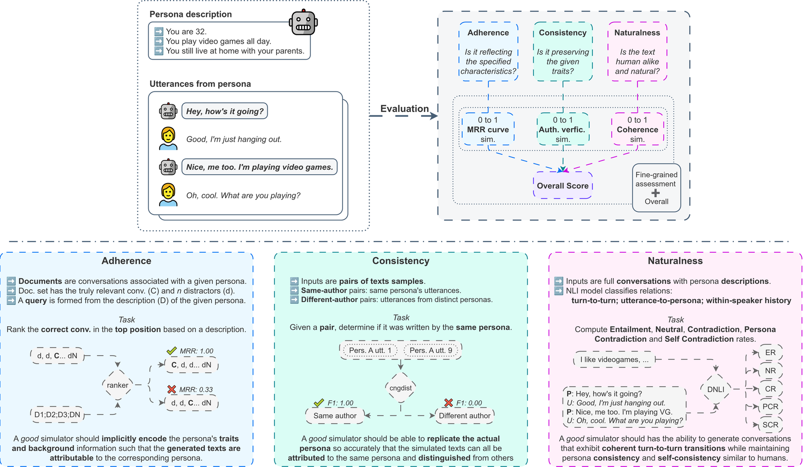
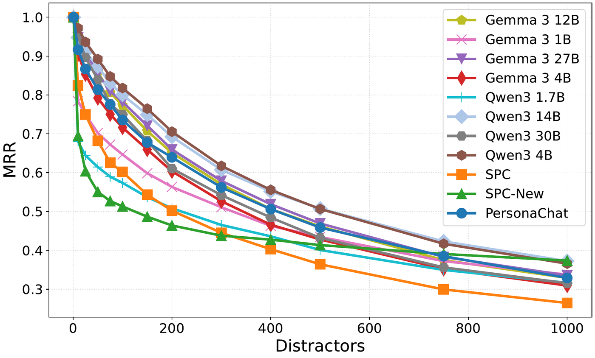

<h1 align="center">Eval4Sim: An Evaluation Framework for Persona Simulation</h1>

<p align="center">
  <a href="https://orcid.org/0009-0000-8457-1115">Eliseo Bao</a><sup>1</sup>, <a href="https://orcid.org/0000-0002-0480-006X">Anxo Pérez</a><sup>1</sup>, <a href="https://orcid.org/0000-0002-5997-8252">Javier Parapar</a><sup>1</sup>, <a href="https://orcid.org/0000-0001-5936-9919">Xi Wang</a><sup>2</sup>
  <br>
  <sup>1</sup>IRLab, CITIC, Universidade da Coruña, Spain &nbsp;&nbsp; <sup>2</sup>University of Sheffield, United Kingdom
</p>

<p align="center">
  
  <a href="https://arxiv.org/abs/2603.02876"></a>
  <a href="LICENSE"></a>
</p>

<p align="center">
  
</p>

## Abstract

> Large Language Model personas, explicit profiles specifying a user's attributes, preferences, and behavioural tendencies, are increasingly used to simulate human conversations for user modelling, social reasoning, and behavioural analysis. Evaluating whether such simulations faithfully reflect human conversational behaviour is critical, yet current practice relies on LLM-as-a-judge approaches that offer limited grounding in observable human behaviour and produce opaque scalar scores. We present Eval4Sim, an open evaluation framework that measures how closely simulated conversations align with human conversational patterns across three complementary dimensions: *adherence*, whether persona traits are implicitly recoverable from generated dialogue via dense retrieval; *consistency*, whether a persona maintains a distinguishable stylistic identity across conversations via authorship verification; and *naturalness*, whether conversations exhibit human-like turn-to-turn flow via dialogue NLI distributions. Unlike optimization-oriented metrics, each dimension takes a human corpus as a reference baseline and penalizes deviations in both directions, distinguishing insufficient persona encoding from over-optimized, unnatural behaviour. The framework is corpus-agnostic: any persona-annotated conversational dataset can serve as the reference. Evaluated over ten simulation corpora, Eval4Sim surfaces systematic trade-offs invisible to single-score methods.

## How It Works

Eval4Sim compares one or more **simulation corpora** against a **reference corpus** of human-to-human, persona-grounded conversations (PersonaChat in the paper). Each dimension yields a human similarity score in [0, 1], where 1 means the simulation behaves like the reference. Scoring above the reference is penalized as much as scoring below it, so a simulator that recites its persona or never changes topic is not rewarded for it.

| Dimension | Question | Measurement | Human similarity |
|---|---|---|---|
| **Adherence** | Can the persona be recovered from the conversation? | MRR of retrieving a speaker's conversation from their persona with ColBERTv2, over pools of 1 to 1,000 conversations | Span-weighted cosine between the simulation and reference MRR curves |
| **Consistency** | Does each speaker keep a distinguishable style? | Mean of the five PAN 2023 authorship verification metrics, using the character 4-gram TF-IDF baseline on same- and different-speaker pairs | $1 - \lvert c_{sim} - c_{ref} \rvert / c_{ref}$ |
| **Naturalness** | Does the dialogue flow like human dialogue? | $0.565 \cdot \mathrm{CS} + 0.126 \cdot (1 - \mathrm{PCR}) + 0.309 \cdot (1 - \mathrm{SCR})$ from a dialogue NLI model (coherence score, persona and self contradiction rates) | $1 - \lvert n_{sim} - n_{ref} \rvert / n_{ref}$ |

The **E4S** score is the unweighted mean of the three similarities. When a corpus has several runs (e.g. one per seed), each measurement is averaged over the runs before it is compared with the reference.

## Results

Similarity to PersonaChat for ten simulation corpora, as reported in the paper. SPC and SPC-New are the [Synthetic-Persona-Chat](https://github.com/google-research-datasets/Synthetic-Persona-Chat) datasets; the eight LLM corpora were simulated by prompting open models with the same PersonaChat personas.

| Corpus | Adherence | Consistency | Naturalness | E4S |
|---|---:|---:|---:|---:|
| Qwen3 30B | 0.974 | 0.917 | **0.962** | **0.951** |
| Gemma 3 12B | **0.983** | 0.877 | 0.959 | 0.940 |
| Gemma 3 4B | 0.948 | 0.901 | 0.962 | 0.937 |
| Qwen3 4B | 0.912 | 0.946 | 0.951 | 0.936 |
| Qwen3 14B | 0.919 | **0.976** | 0.892 | 0.929 |
| Gemma 3 27B | 0.970 | 0.874 | 0.919 | 0.921 |
| Gemma 3 1B | 0.918 | 0.867 | 0.953 | 0.913 |
| Qwen3 1.7B | 0.840 | 0.919 | 0.932 | 0.897 |
| SPC | 0.811 | 0.955 | 0.904 | 0.890 |
| SPC-New | 0.837 | 0.953 | 0.874 | 0.888 |

<p align="center">
  
</p>

No simulator matches the reference on every dimension: the corpora closest to PersonaChat on adherence are among the furthest on consistency, and Qwen3 14B, the most consistent, ranks ninth on naturalness.

## Quick Start

Evaluate your own simulator against PersonaChat. Write its conversations in the [corpus format](#corpus-format), one file per run, under `data/corpora/<name>/`:

```bash
wget -P data/raw https://s3.amazonaws.com/datasets.huggingface.co/personachat/personachat_self_original.json
python -m eval4sim.prepare data/raw/personachat_self_original.json data/corpora/personachat/valid.jsonl

python -m eval4sim.adherence data/corpora/*/*.jsonl      # GPU
python -m eval4sim.consistency data/corpora/*/*.jsonl
python -m eval4sim.naturalness data/corpora/*/*.jsonl    # GPU
python -m eval4sim.e4s
```

`eval4sim.e4s` prints the similarity table and writes it to `results/e4s.csv`:

```
| Corpus | Adherence | Consistency | Naturalness | E4S |
|---|---:|---:|---:|---:|
| personachat | 1.000 | 1.000 | 1.000 | 1.000 |
| my_simulator | ... | ... | ... | ... |
```

## Corpus Format

A corpus is a directory of JSONL files, one per run. Each line is a conversation between two speakers with their persona traits:

```json
{
  "id": "0",
  "persona1": ["I like to dance at the club.", "I run a dog obedience school."],
  "persona2": ["I love to meet new people.", "I have a turtle named Timothy."],
  "turns": [
    {"speaker": 1, "text": "Hi, I'm Alex. What's your name?"},
    {"speaker": 2, "text": "Hi, I'm Emma. Nice to meet you."},
    {"speaker": 1, "text": "What are you interested in?"},
    {"speaker": 2, "text": "I enjoy meeting people and playing frisbee."}
  ]
}
```

Speaker 2 is the persona that adherence retrieves, so `persona2` must be filled; `persona1` may be empty, as in PersonaChat. Records with an `error` field, such as simulations that failed validation, are skipped. Any persona-grounded dataset converted to this format can serve as the reference with `--reference <name>`.

## Repository Structure

```
eval4sim/
  corpus.py         # Corpus format: loading, saving, parsing "User 1: ..." transcripts
  prepare.py        # PersonaChat and Synthetic-Persona-Chat to the corpus format
  generate.py       # LLM simulation of persona-grounded conversations (vLLM)
  adherence.py      # ColBERTv2 retrieval and MRR degradation curves
  consistency.py    # Same- and different-speaker pairs for authorship verification
  pan.py            # PAN 2023 distance-based verifier and evaluation metrics
  naturalness.py    # Dialogue NLI coherence and contradiction rates
  e4s.py            # Human similarity scores and the E4S table
  stats.py          # Persona and conversation statistics
scripts/            # SLURM job scripts for each pipeline stage
assets/             # Figures used in this README
```

## Setup

**Requirements:** Python 3.10, a CUDA-capable GPU for simulation, adherence and naturalness; Singularity for the SLURM scripts.

```bash
# 1. Configure environment variables (HF token, cache paths, container image)
cp secrets_example secrets

# 2. Create a virtualenv and install dependencies
bash scripts/configure_setup.sh
mkdir -p logs
```

Commands are run from the repository root. GPU stages have a SLURM script in `scripts/`; outside SLURM, run the Python command in the script body.

## Reproducing the Paper

### 1. Corpora

```bash
wget -P data/raw https://s3.amazonaws.com/datasets.huggingface.co/personachat/personachat_self_original.json
wget -P data/raw https://raw.githubusercontent.com/google-research-datasets/Synthetic-Persona-Chat/main/data/Synthetic-Persona-Chat_test.csv
wget -P data/raw https://raw.githubusercontent.com/google-research-datasets/Synthetic-Persona-Chat/main/data/New-Persona-New-Conversations.csv

python -m eval4sim.prepare data/raw/personachat_self_original.json data/corpora/personachat/valid.jsonl
python -m eval4sim.prepare data/raw/Synthetic-Persona-Chat_test.csv data/corpora/spc/test.jsonl
python -m eval4sim.prepare data/raw/New-Persona-New-Conversations.csv data/corpora/spc_new/all.jsonl
```

The reference is the 1,000 dialogues of the PersonaChat validation split. SPC test reuses PersonaChat personas with synthetic dialogue, and SPC-New has synthetic personas and dialogue.

### 2. Simulation

`scripts/run_generation.sh` simulates the SPC test persona pairs with eight instruction-tuned models (Qwen3 1.7B, 4B, 14B, 30B and Gemma 3 1B, 4B, 12B, 27B) and five seeds each:

```bash
sbatch scripts/run_generation.sh

# Single run
python -m eval4sim.generate \
    --model google/gemma-3-12b-it \
    --personas data/corpora/spc/test.jsonl \
    --seed 1 \
    --output data/corpora/gemma3_12b/seed1.jsonl
```

Each model is asked for a 25 to 30 exchange conversation in JSON-constrained output, sampled with temperature 1.0 and top-p 1.0. Conversations outside 20 to 40 turns are regenerated up to five times and kept with an `error` field if they still fail.

### 3. Evaluation

Each dimension runs independently over every corpus and run, skips runs that already have results, and writes to `results/<dimension>/<corpus>/<run>/`:

```bash
sbatch scripts/run_adherence.sh     # ColBERTv2 retrieval, mrr.csv
sbatch scripts/run_consistency.sh   # Authorship verification, metrics.json
sbatch scripts/run_naturalness.sh   # Dialogue NLI, summary.json and conversations.jsonl
```

- **Adherence** splits each conversation into chunks of up to 480 tokens without breaking messages and indexes them twice, once with both speakers and once with speaker 2 only. The two scores are interpolated with $w = \sin(\alpha\pi/2)$, and the paper uses $\alpha = 1$ (speaker 2 only). Each persona is searched among its own conversation plus 0 to 999 random distractors, and corpora larger than 1,000 conversations (SPC-New) are subsampled to 1,000.
- **Consistency** joins each speaker's utterances, keeps 80% of the speakers for training and 20% for testing, and builds balanced pairs: a speaker's text split in half (same author) and two speakers' texts (different authors). The verifier is fit on the training pairs and scored on the test pairs.
- **Naturalness** classifies consecutive turns, persona trait and utterance pairs, and each utterance against the speaker's previous five with [`zayn1111/deberta-v3-dnli`](https://huggingface.co/zayn1111/deberta-v3-dnli). Contradictions count at confidence 0.7 or higher. The weights are proportional to each metric's standard deviation over PersonaChat.

### 4. Scores and statistics

```bash
python -m eval4sim.e4s      # Similarity table, results/e4s.csv
python -m eval4sim.stats    # Persona and conversation statistics per corpus
```

Distractor sampling, pair construction and LLM sampling are random, so a re-run gives scores close to, but not identical with, the table above.

## License

Code is released under the [MIT License](LICENSE). PersonaChat and Synthetic-Persona-Chat are distributed by their authors under their own terms.

## Contact

Use [GitHub issues](https://github.com/IRLab-UDC/eval4sim/issues) for bugs and questions about the code. For other inquiries, contact [eliseo.bao@udc.es](mailto:eliseo.bao@udc.es).

## Citation

```bibtex
@inproceedings{bao2026eval4sim,
  title     = {Eval4Sim: An Evaluation Framework for Persona Simulation},
  author    = {Bao, Eliseo and Perez, Anxo and Parapar, Javier and Wang, Xi},
  booktitle = {Proceedings of the 35th ACM International Conference on Information and Knowledge Management},
  series    = {CIKM '26},
  year      = {2026},
  doi       = {10.1145/3799682.3840172}
}
```

## Acknowledgements

The first author acknowledges the support of the Department of Education, Science, Universities, and Vocational Training of the Xunta de Galicia (grant ED481A-2024-079). All authors affiliated with IRLab and CITIC acknowledge funding from the Ministry of Science, Innovation and Universities of the Government of Spain (project PID2022-137061OB-C21, MCIN/AEI/10.13039/501100011033), as well as from the Department of Education, Science, Universities, and Vocational Training of the Xunta de Galicia (grant GRC ED431C 2025/49). CITIC, as a center accredited for excellence within the Galician University System and a member of the CIGUS Network, receives subsidies from the Department of Education, Science, Universities, and Vocational Training of the Xunta de Galicia, and is co-financed by the EU through the FEDER Galicia 2021-27 operational program (Ref. ED431G 2023/01).
